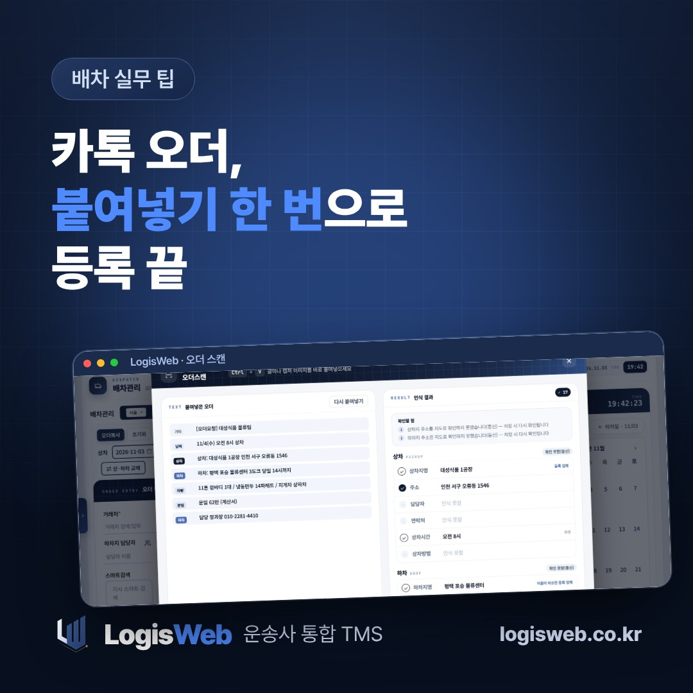
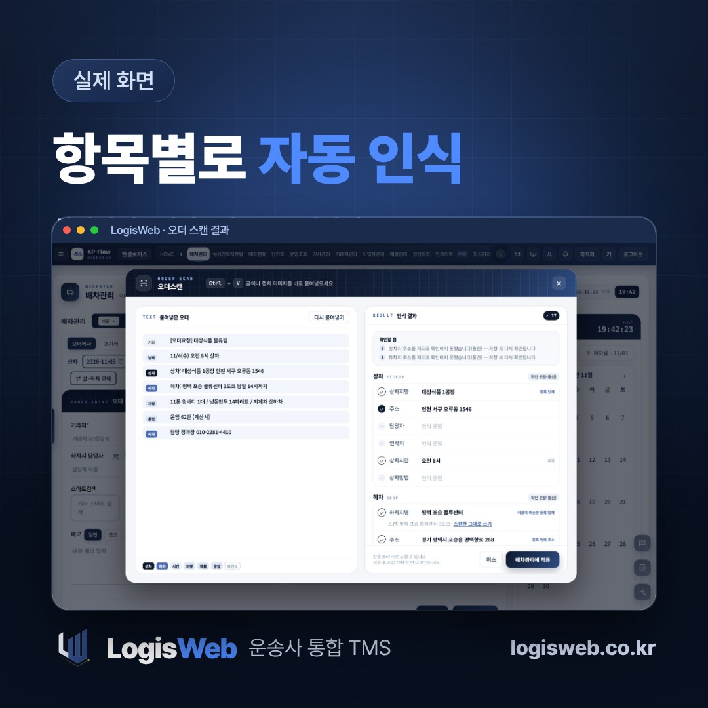
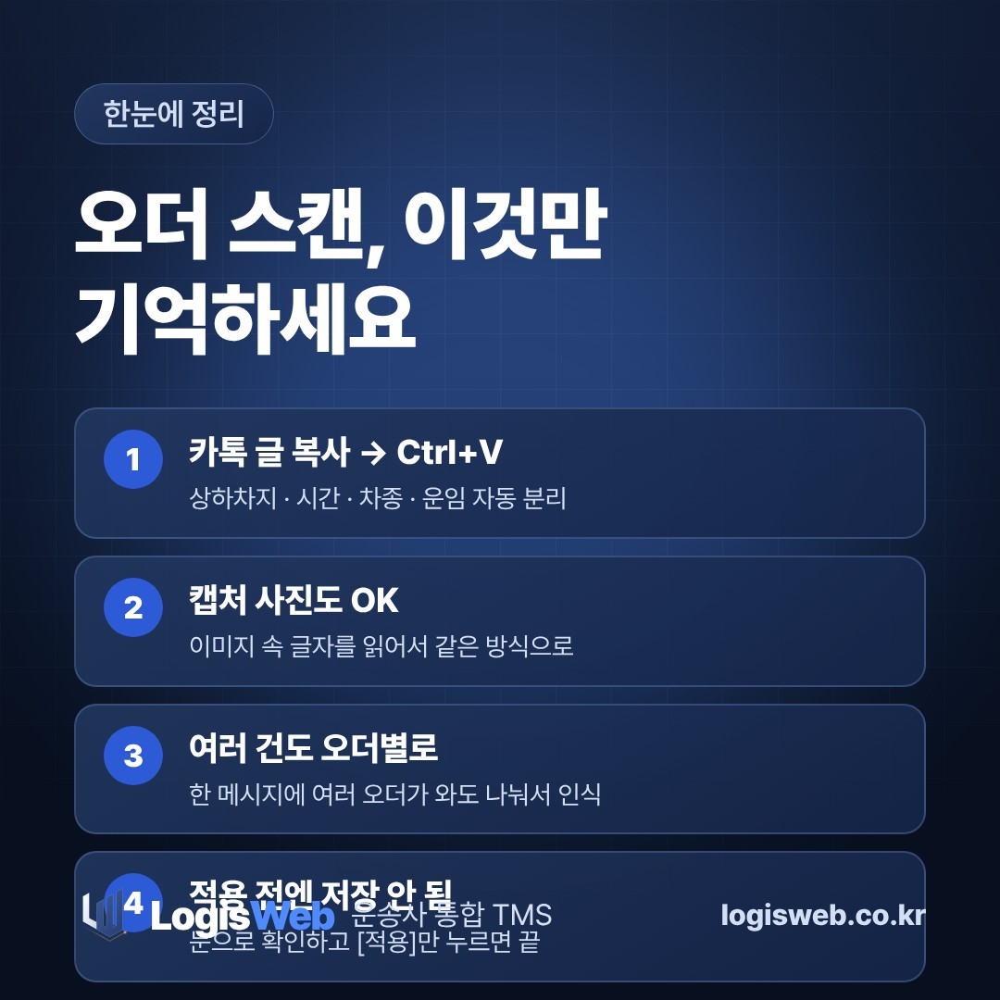

배차 일을 해 보신 분이라면 이 장면, 익숙하실 거예요.

카톡방에 오더가 올라와요. 상차지, 하차지, 시간, 차종, 운임… 그걸 보고 엑셀이나 프로그램에 **한 칸씩 다시 쳐 넣어요.** 한 건에 2~3분이라도, 하루 오더가 50건이면 입력만 두 시간 가까이 걸려요(예를 들어 계산해 본 숫자예요).

더 큰 문제는 시간이 아니라 **실수**예요. 전화번호 한 자리, 하차 시간 하나만 틀려도 그날 배차가 꼬이죠.

## 붙여넣기 한 번이면 칸이 채워져요

로지스웹의 **오더 스캔**은 이 일을 줄이려고 만든 기능이에요.

1. 카톡에서 오더 글을 길게 눌러 **복사**해요.
2. 로지스웹 배차 화면에서 **[오더스캔]**을 누르고 **Ctrl + V** 로 붙여넣어요.
3. 상차지 · 하차지 · 담당자 · 연락처 · 상하차 시간 · 차종 · 화물 · 운임이 **항목별로 나뉘어** 들어가요.
4. 맞는지 눈으로 확인하고 **[배차관리에 적용]**을 누르면 끝이에요.

적용을 누르기 전까지는 저장되지 않아요. 그래서 처음 쓰는 분도 안심하고 눌러 볼 수 있어요.

## 캡처 사진으로 받아도 똑같아요

화주사가 글 대신 **캡처 이미지**를 보내는 경우도 많죠. 그 사진을 그대로 붙여넣어도 글자를 읽어서 같은 방식으로 칸을 채워 줘요.

- 한 메시지에 오더가 여러 건이어도 **오더별로 나눠서** 인식해요.
- 이미 등록한 거래처 · 상하차지가 있으면 **자동으로 찾아서 연결**해요.
- 고칠 칸이 있으면 결과 화면에서 바로 눌러서 고치면 돼요.

## 이런 분께 특히 좋아요

- 오더를 카톡 · 문자로 받는 **주선사 · 운송사 배차 담당자**
- 신입 배차 담당자가 입력 실수를 자주 하는 팀
- 저녁마다 다음 날 오더를 몰아서 입력하는 분

> "배차 완료 여부를 엑셀에서 찾지 않아도 되는 시스템. 현장에서 가장 필요했던 것을 만들었습니다." — 로지스웹은 배차 실무 10년 차 배차팀장이 설계부터 직접 참여해 만든 프로그램이에요.

## 무료로 먼저 써 보세요

로지스웹은 오더 스캔뿐 아니라 실시간배차현황, 기사앱 위치 관제, 정산까지 **한 화면**에서 이어져요. 우리 회사 오더 글로 직접 붙여넣어 보는 게 제일 빨라요.

👉 무료 체험 신청: **logisweb.co.kr** (검색창에 "로지스웹")
