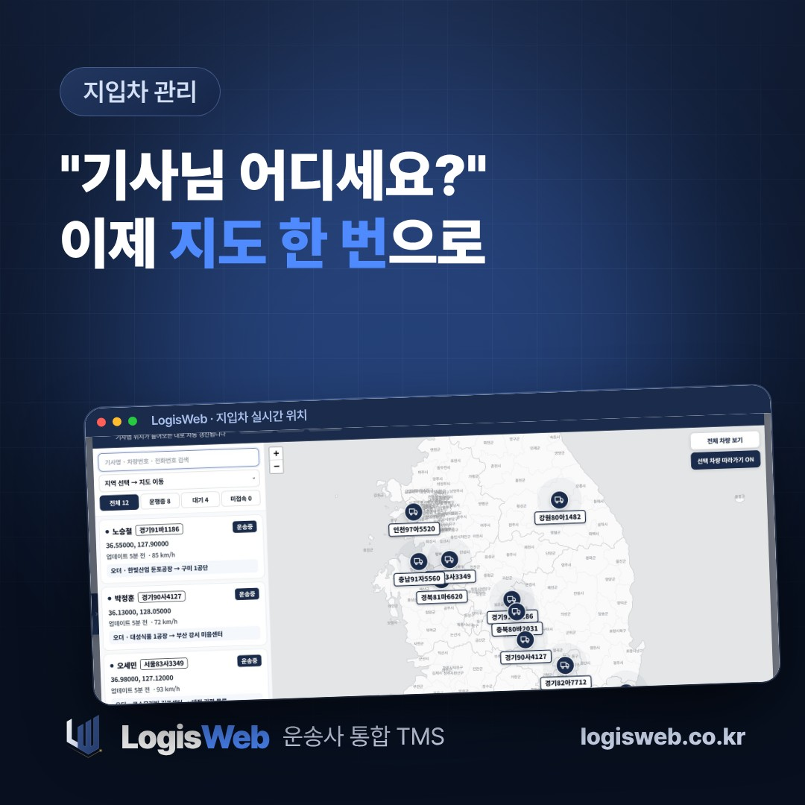
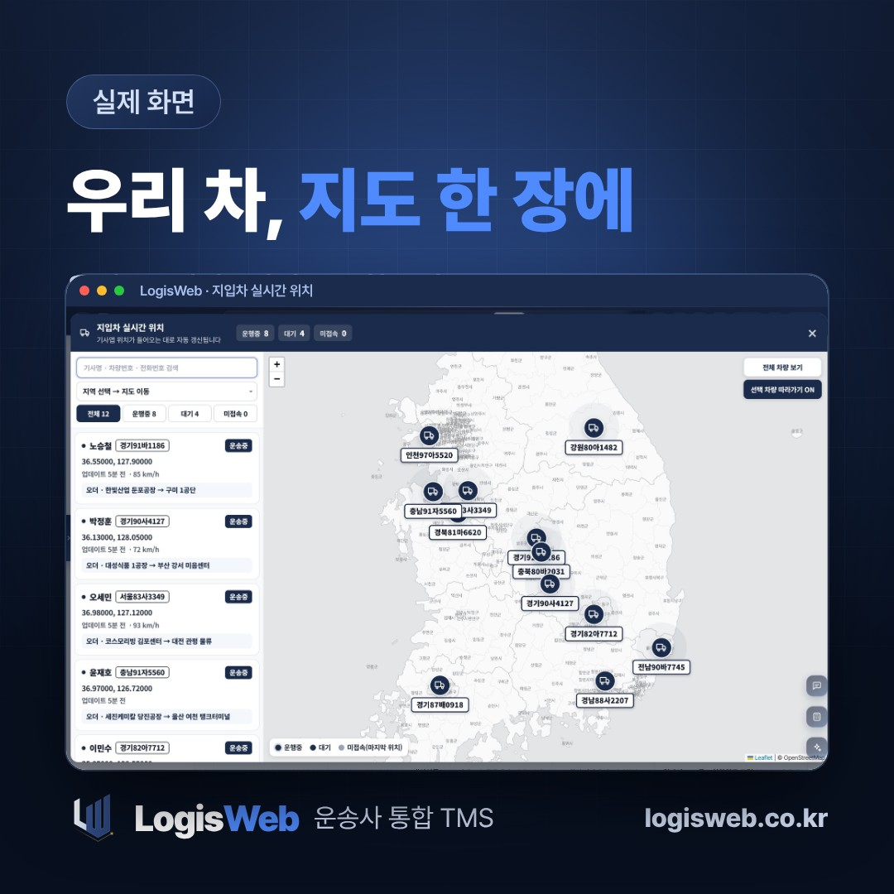
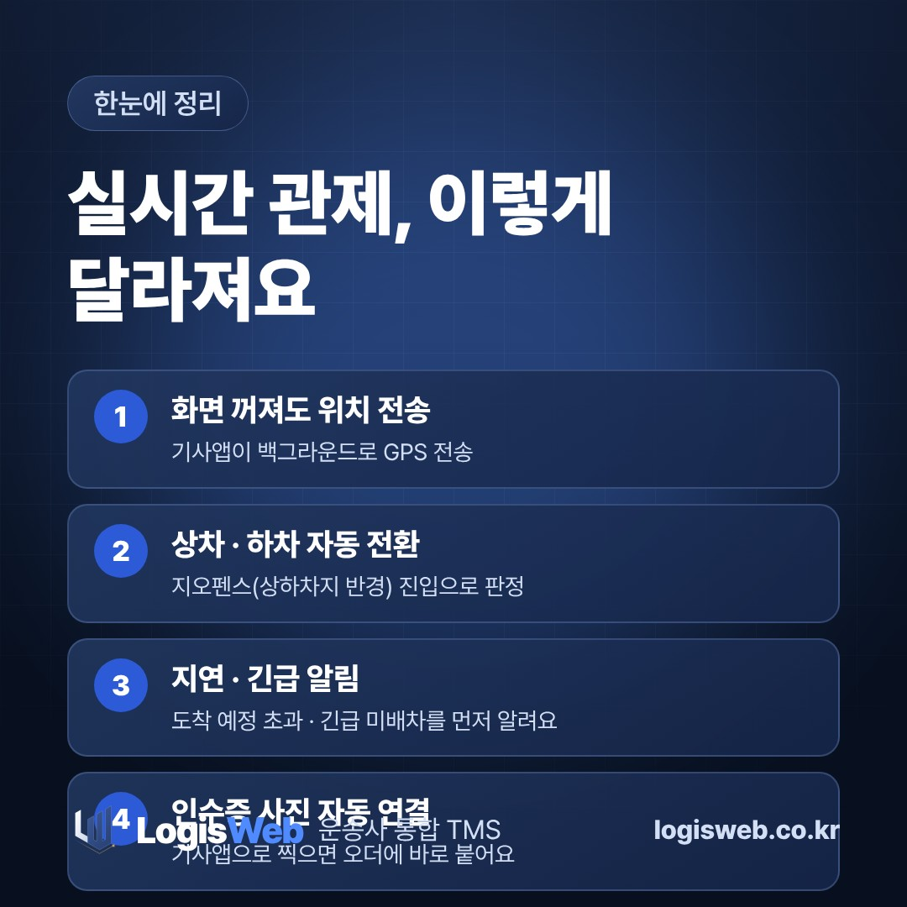

"기사님, 지금 어디쯤이세요?"

배차실에서 하루에 가장 많이 하는 말 중 하나예요. 화주사에서 "차 언제 와요?" 전화가 오면, 우리는 다시 기사님께 전화를 걸어요. 운전 중이라 못 받으시면 또 기다리고요.

## 기사앱을 켜 두면 위치가 알아서 올라와요

로지스웹 **기사앱**을 기사님 휴대폰에 설치해 두면, 위치가 회사 화면으로 자동으로 올라와요.

- **화면이 꺼져 있어도** 백그라운드로 위치를 보내요.
- 마지막 위치와 **갱신 시각**이 같이 보여서, 얼마나 최근 위치인지 바로 알 수 있어요.
- 일반 기사님 기사앱은 **무료 · 무제한**이에요.

## 지도 한 장에 우리 차가 전부 보여요

**[지입차 실시간 위치]** 화면을 열면 운행중 · 대기 · 미접속 차량이 지도와 목록에 한 번에 나와요. 차량을 누르면 지금 맡은 오더(어디서 어디로), 속도, 연락처까지 보여요.

화주사에서 전화가 오면 지도를 보고 바로 답하면 돼요. 기사님께 다시 전화할 필요가 없어요.

## 상차 · 하차는 지오펜스가 알아서 바꿔요

**지오펜스**는 상차지 · 하차지 주변에 그어 둔 보이지 않는 원이에요.

1. 차가 상차지 원 안으로 들어가면 → **상차 도착**
2. 원 밖으로 나가 달리기 시작하면 → **운송중**
3. 하차지 원 안으로 들어가면 → **하차 도착**

상태가 자동으로 바뀌니까, 기사님이 버튼을 누르지 않아도 배차 화면에서 진행 상황을 볼 수 있어요. 도착 예정 시각을 넘기거나 긴급 미배차가 생기면 담당자에게 알림도 가요.

## 인수증 사진도 오더에 바로 붙어요

하차가 끝나면 기사님이 기사앱으로 인수증을 찍어요. 사진은 **해당 오더에 자동으로 연결**돼서, 담당자가 카톡으로 받은 사진을 다시 화주사에 보낼 일이 줄어요.

## 무료로 먼저 써 보세요

위치 확인 전화가 줄어들면, 그 시간에 배차를 한 건 더 잡을 수 있어요.

👉 무료 체험 신청: **logisweb.co.kr** (검색창에 "로지스웹")

※ 지입차 관제(GPS · 운행기록 · 사진)는 스탠다드 요금제부터 포함돼요.
