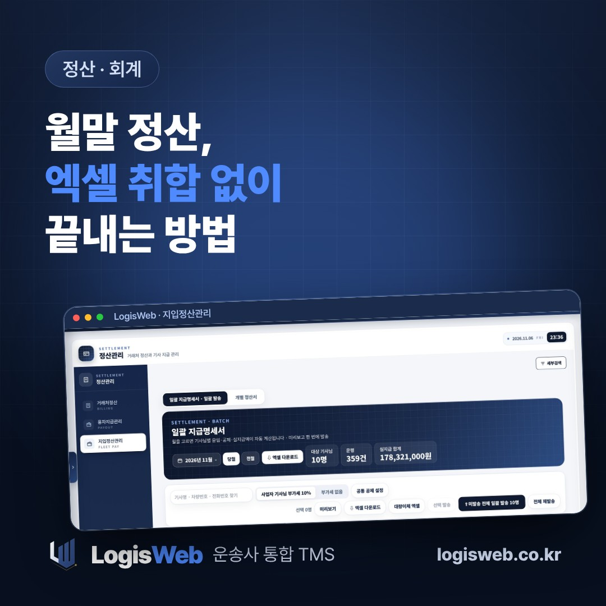
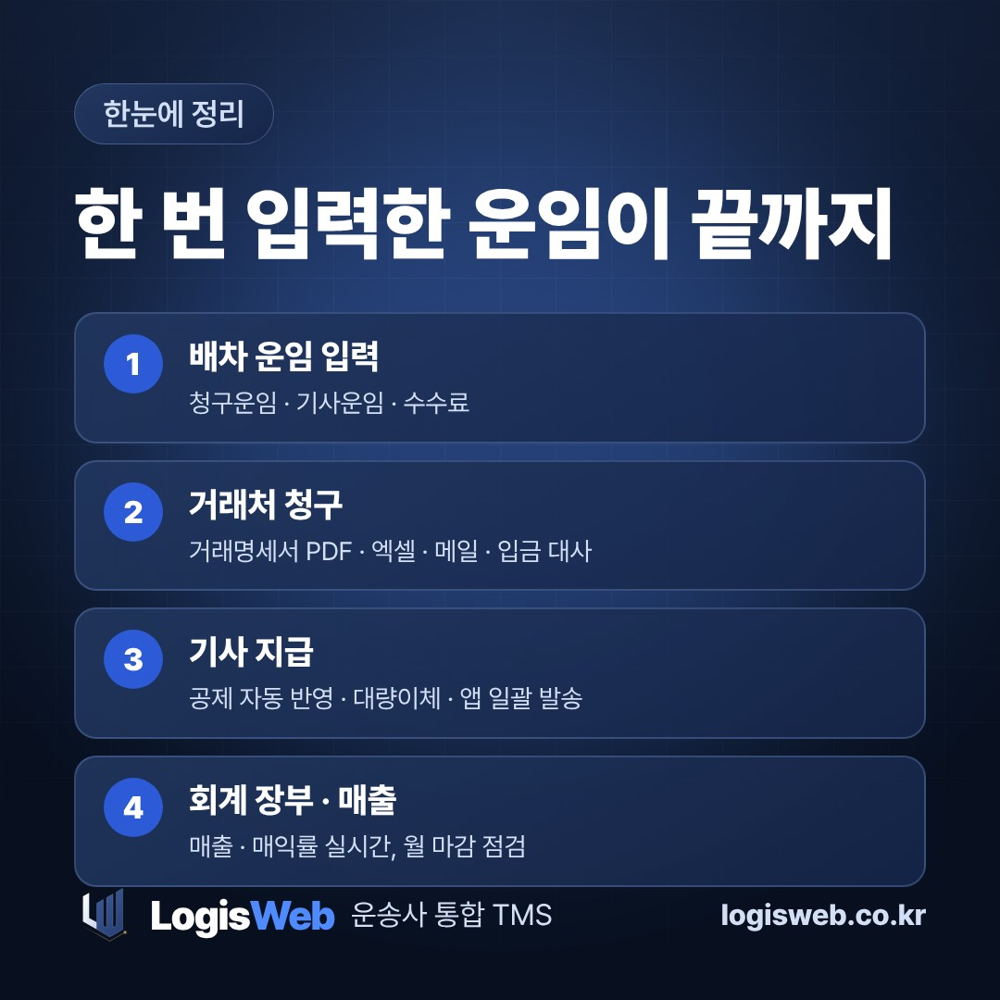
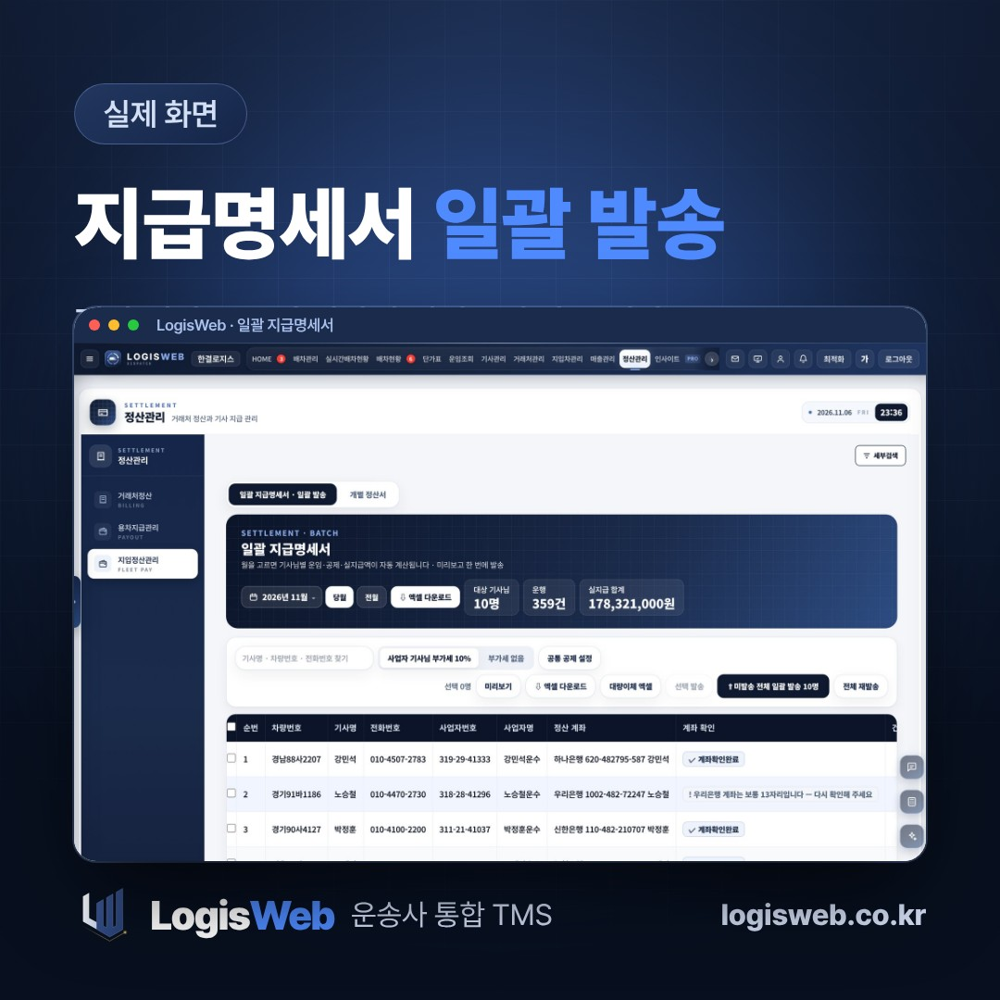

월말이 되면 배차실 모니터에 엑셀 창이 몇 개씩 떠 있죠. 거래처별 청구 파일, 기사 지급 파일, 매출 집계 파일… 그리고 어느 순간 파일 이름이 **"최종_진짜최종"**이 돼요.

정산이 힘든 이유는 단순해요. **배차할 때 이미 넣은 운임을, 정산할 때 다시 모으기 때문**이에요.

## 배차할 때 넣은 운임이 그대로 정산이 돼요

로지스웹은 처음부터 데이터가 한 줄로 이어지게 만들었어요.

**오더 → 배차 → 관제 → 인수증 → 정산 → 매출**

배차할 때 넣은 **청구운임 · 기사운임 · 수수료**가 그대로 거래처 청구와 기사 지급, 회계 장부로 넘어가요. 월말에 다시 모을 게 없어요.

## 거래처 정산: 거래명세서를 바로 뽑아요

- 거래처를 고르면 그 달 운송 내역이 모여요.
- **거래명세서 PDF · 엑셀**로 바로 뽑고, 메일로 보낼 수 있어요.
- 입금이 들어오면 **입금 대사**로 미수금을 확인해요.

## 지입 기사 지급: 명세서를 한 번에 보내요

**[지입정산관리 → 일괄 지급명세서]**에서 정산 월만 고르면 기사별 운행 건수 · 운임 · 공제 · 실지급액이 계산돼요.

- 지입료 · 부가세 · 과태료 같은 **공제 항목**이 자동으로 들어가요.
- 정산 계좌 형식을 확인하고 **대량이체 파일**을 만들어요.
- 검토가 끝나면 **기사앱으로 일괄 발송**해요. 기사님은 앱 서류함에서 바로 확인해요.

## 마감 전에 실수를 먼저 찾아 줘요

**월 마감 점검**이 운임 누락, 지급 방식 불일치 같은 것을 먼저 알려 줘요. 마감하고 나서 발견하는 일을 줄여 줘요. 매출 · 매익률은 **매출 대시보드**에서 실시간으로 볼 수 있어요.

※ 홈택스 세금계산서 연동은 지금 준비 중이에요.

## 무료로 먼저 써 보세요

👉 무료 체험 신청: **logisweb.co.kr** (검색창에 "로지스웹")
