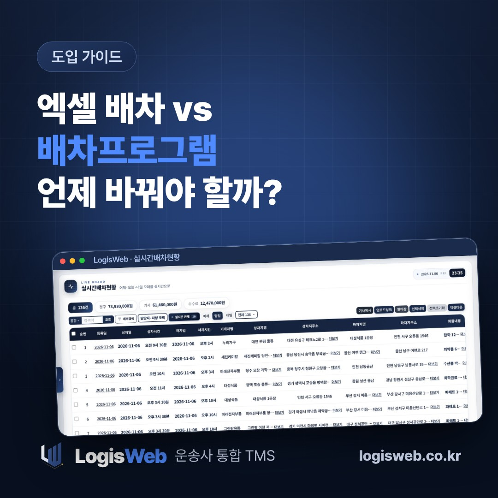
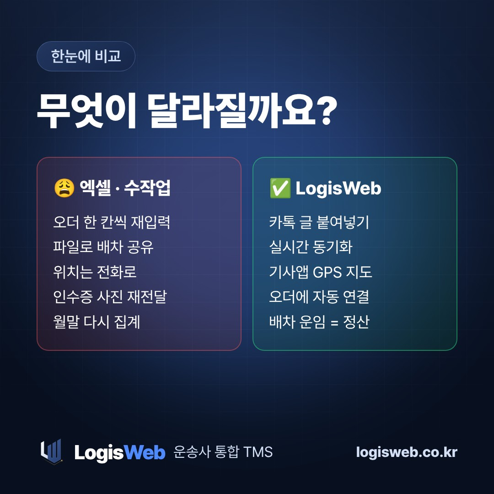
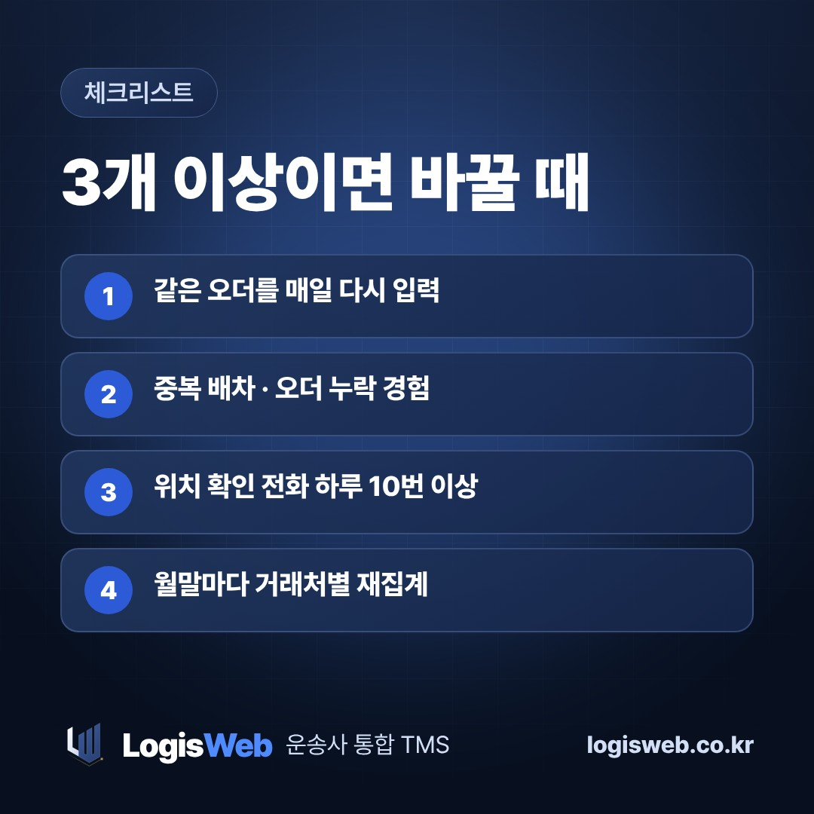

처음엔 엑셀이 제일 편해요. 무료고, 다들 쓸 줄 알고요. 그런데 직원이 늘고 오더가 많아지면 엑셀이 일을 **만들기** 시작해요.

## 이 중 3개 이상이면 바꿀 때예요

1. 같은 오더를 **매일 다시 입력**하고 있다
2. 두 사람이 같은 오더에 **중복 배차**한 적이 있다
3. 누락된 오더를 찾으려고 **카톡 기록을 뒤진** 적이 있다
4. 차 위치를 알려고 **하루 10번 넘게 전화**한다
5. 기사가 보낸 인수증 사진을 **다시 화주사에 전달**한다
6. 월말마다 거래처별 내역을 **따로 다시 집계**한다
7. 이번 달 매출 · 수익을 물으면 **바로 대답하기 어렵다**

## 엑셀 vs 로지스웹, 무엇이 달라질까요?

| 일 | 엑셀 · 수작업 | 로지스웹 |
|---|---|---|
| 오더 입력 | 한 칸씩 다시 입력 | 카톡 글 · 캡처 붙여넣기 |
| 배차 공유 | 파일 저장 · 공유 | 실시간 동기화 |
| 위치 확인 | 전화 | 기사앱 GPS 지도 |
| 인수증 | 카톡 사진 전달 | 오더에 자동 연결 |
| 정산 | 월말 다시 집계 | 배차 운임이 그대로 |
| 매출 | 따로 계산 | 대시보드 실시간 |

## 도입은 이렇게 해요

1. **무료 체험 신청** — 홈페이지에서 신청서를 남겨요.
2. **데이터 옮기기** — 거래처 · 기사 · 운임 데이터를 그대로 옮겨 드려요.
3. **같이 써 보기** — 실제 오더로 써 보면서 화면을 익혀요.
4. **기사앱 설치** — 기사님은 안드로이드 앱(APK)만 설치하면 돼요. 기사앱은 무료예요.

## 요금은 얼마예요?

직원 수와 오더 수에 맞춰 고르면 돼요(VAT 별도, 12개월 약정 기준).

- 라이트 월 89,000원 — 1인 주선 · 2~3인
- 베이직 월 199,000원 — 4~6인
- 스탠다드 월 349,000원 — 7~10인, 지입차 관제 포함
- 프로 월 590,000원 — 11인 이상

## 무료로 먼저 써 보세요

체크리스트에서 3개 이상 해당된다면, 우리 회사 오더로 한 번 써 보시는 걸 추천해요.

👉 무료 체험 신청: **logisweb.co.kr** (검색창에 "로지스웹")
